# Diagrama de classes — Mini-SCADA

Gerado a partir do código em `src/` (pacote `com.grupo8.scada`). O GitHub renderiza o diagrama abaixo automaticamente.
Versão em PlantUML (para gerar PNG/SVG): [`MiniSCADA.puml`](MiniSCADA.puml).

```mermaid
classDiagram
    direction TB

    %% ===================== model =====================
    class Equipamento {
        <<abstract>>
        -String id
        -String nome
        -EstadoEquipamento estado
        -long ciclosExecutados
        #Equipamento(String id, String nome)
        +ligar() void
        +desligar() void
        +pararEmergencia() void
        +definirFalha() void
        +rearmar() boolean
        +iniciarManutencao() void
        +concluirManutencao() void
        +ciclo() void
        #executarCiclo()* void
        #podeRearmar() boolean
        #aoManterFalha() void
        +getTipo()* String
        +getId() String
        +getNome() String
        +getEstado() EstadoEquipamento
        +getCiclosExecutados() long
    }

    class Forno {
        -double temperatura
        -double setpoint
        -double histerese
        -double limiteSeguranca
        -boolean resistenciaLigada
        +Forno(id, nome, temperaturaInicial, setpoint, histerese, limiteSeguranca)
        #executarCiclo() void
        #aoManterFalha() void
        #podeRearmar() boolean
        +getTipo() String
        +ajustarSetpoint(double valor) void
        +getSetpoint() double
        +gerarLeituras() List~Leitura~
        +getTemperatura() double
        +getHisterese() double
        +getLimiteSeguranca() double
        +isResistenciaLigada() boolean
    }

    class Esteira {
        -double velocidade
        -double velocidadeMaxima
        -long biscoitosTransportados
        +Esteira(id, nome, velocidadeInicial, velocidadeMaxima)
        #executarCiclo() void
        +getTipo() String
        +ajustarSetpoint(double valor) void
        +getSetpoint() double
        +gerarLeituras() List~Leitura~
        +getBiscoitosTransportados() long
        +getVelocidadeMaxima() double
    }

    class Empacotadora {
        -double estoqueFilme
        -double consumoPorCiclo
        -double estoqueMinimo
        -long pacotesProduzidos
        +Empacotadora(id, nome, estoqueInicial, consumoPorCiclo, estoqueMinimo)
        #executarCiclo() void
        +getTipo() String
        +gerarLeituras() List~Leitura~
        +reabastecer(double quantidade) void
        +getEstoqueFilme() double
        +getPacotesProduzidos() long
        +getConsumoPorCiclo() double
        +getEstoqueMinimo() double
    }

    class Paletizador {
        -long limiteCiclosManutencao
        -long ciclosDesdeManutencao
        -int caixasNoPalete
        -long paletesConcluidos
        +Paletizador(id, nome, limiteCiclosManutencao)
        #executarCiclo() void
        +getTipo() String
        +precisaManutencao() boolean
        +realizarManutencao() void
        +gerarLeituras() List~Leitura~
        +getCaixasNoPalete() int
        +getPaletesConcluidos() long
        +getLimiteCiclosManutencao() long
    }

    class Leitura {
        -String origem
        -String grandeza
        -double valor
        -String unidade
        -double limiteMinimo
        -double limiteMaximo
        -LocalDateTime instante
        +foraDoLimite() boolean
        +getOrigem() String
        +getGrandeza() String
        +getValor() double
        +getUnidade() String
        +getInstante() LocalDateTime
    }

    class Alarme {
        -String origem
        -Severidade severidade
        -String mensagem
        -LocalDateTime instante
        -boolean ativo
        +Alarme(origem, severidade, mensagem)
        +isAtivo() boolean
        +resolver() void
        +getOrigem() String
        +getSeveridade() Severidade
        +getMensagem() String
        +getInstante() LocalDateTime
    }

    class EstadoEquipamento {
        <<enumeration>>
        PARADO
        OPERANDO
        FALHA
        MANUTENCAO
    }

    class Severidade {
        <<enumeration>>
        INFO
        AVISO
        CRITICO
    }

    %% ===================== model.interfaces =====================
    class Ajustavel {
        <<interface>>
        +ajustarSetpoint(double valor) void
        +getSetpoint() double
    }

    class Monitoravel {
        <<interface>>
        +gerarLeituras() List~Leitura~
    }

    class Manutenivel {
        <<interface>>
        +precisaManutencao() boolean
        +realizarManutencao() void
    }

    %% ===================== service =====================
    class Supervisorio {
        -List~Equipamento~ equipamentos
        -GerenciadorAlarmes gerenciadorAlarmes
        -List~Thread~ threadsEquipamentos
        -Thread threadMonitor
        -Thread threadHistoriador
        -boolean iniciado
        +iniciar() void
        +pararEmergencia() void
        +desligarSistema() void
        +buscar(String id) Equipamento
        +realizarManutencao(String id) boolean
        +reabastecerEmpacotadora(String id, double quantidade) boolean
        +rearmar(String id) boolean
        +getEquipamentos() List~Equipamento~
        +getGerenciadorAlarmes() GerenciadorAlarmes
        +isIniciado() boolean
    }

    class GerenciadorAlarmes {
        -List~Alarme~ alarmes
        +registrar(Alarme novo) void
        +registrar(String origem, Severidade severidade, String mensagem) void
        +ativos() List~Alarme~
        +todos() List~Alarme~
        +resolver(String origem, String prefixoMensagem) void
    }

    %% ===================== threads =====================
    class TarefaEquipamento {
        -Equipamento equipamento
        -long intervaloMs
        +run() void
    }

    class MonitorProcesso {
        -List~Equipamento~ equipamentos
        -GerenciadorAlarmes gerenciador
        -long intervaloMs
        +run() void
    }

    class Historiador {
        -List~Equipamento~ equipamentos
        -RegistradorCsv registrador
        -GerenciadorAlarmes gerenciador
        -long intervaloMs
        -Set~Alarme~ jaRegistrados
        +run() void
    }

    class Runnable {
        <<interface>>
        +run() void
    }

    %% ===================== persistence =====================
    class Repositorio~T~ {
        <<interface>>
        +carregar() List~T~
        +salvar(List~T~ itens) void
    }

    class RepositorioEquipamentosCsv {
        -Path arquivo
        +carregar() List~Equipamento~
        +salvar(List~Equipamento~ itens) void
        -num(String[] campos, int i) double
    }

    class RegistradorCsv {
        -Path historico
        -Path alarmes
        +registrarLeituras(List~Leitura~ leituras) void
        +registrarAlarmes(List~Alarme~ lista) void
        -append(Path arquivo, String cabecalho, String linha) void
    }

    %% ===================== ui / main =====================
    class ConsoleOperador {
        -Supervisorio supervisorio
        -Scanner scanner
        +executar() void
        -mostrarMenu() void
        -listarEquipamentos() void
        -ajustarSetpoint() void
        -mostrarAlarmes() void
        -manutencao() void
        -rearmar() void
        -reabastecerEmpacotadora() void
    }

    class Main {
        +main(String[] args)$ void
        -criarPlantaPadrao()$ List~Equipamento~
    }

    %% ===================== exceptions =====================
    class ScadaException {
        +ScadaException(String mensagem)
        +ScadaException(String mensagem, Throwable causa)
    }
    class ConfiguracaoInvalidaException {
        +ConfiguracaoInvalidaException(String mensagem)
        +ConfiguracaoInvalidaException(String mensagem, Throwable causa)
    }
    class EquipamentoEmFalhaException {
        +EquipamentoEmFalhaException(String mensagem)
    }
    class SetpointInvalidoException {
        +SetpointInvalidoException(String mensagem)
    }
    class Exception {
        <<Java>>
    }

    %% ===================== herança =====================
    Equipamento <|-- Forno
    Equipamento <|-- Esteira
    Equipamento <|-- Empacotadora
    Equipamento <|-- Paletizador

    Exception <|-- ScadaException
    ScadaException <|-- ConfiguracaoInvalidaException
    ScadaException <|-- EquipamentoEmFalhaException
    ScadaException <|-- SetpointInvalidoException

    %% ===================== realização de interfaces =====================
    Ajustavel <|.. Forno
    Ajustavel <|.. Esteira
    Monitoravel <|.. Forno
    Monitoravel <|.. Esteira
    Monitoravel <|.. Empacotadora
    Monitoravel <|.. Paletizador
    Manutenivel <|.. Paletizador
    Repositorio <|.. RepositorioEquipamentosCsv
    Runnable <|.. TarefaEquipamento
    Runnable <|.. MonitorProcesso
    Runnable <|.. Historiador

    %% ===================== associações =====================
    Equipamento --> EstadoEquipamento : estado
    Alarme --> Severidade : severidade
    Supervisorio o-- "0..*" Equipamento : equipamentos
    Supervisorio o-- "1" GerenciadorAlarmes
    GerenciadorAlarmes o-- "0..*" Alarme
    ConsoleOperador --> Supervisorio
    TarefaEquipamento --> Equipamento : executa ciclo
    MonitorProcesso --> "0..*" Equipamento : monitora
    MonitorProcesso --> GerenciadorAlarmes : registra alarmes
    Historiador --> "0..*" Equipamento : lê
    Historiador --> GerenciadorAlarmes : lê alarmes
    Historiador --> RegistradorCsv : grava

    %% ===================== dependências =====================
    Supervisorio ..> TarefaEquipamento : cria
    Supervisorio ..> MonitorProcesso : cria
    Supervisorio ..> Historiador : cria
    Supervisorio ..> RegistradorCsv : cria
    Main ..> RepositorioEquipamentosCsv : usa
    Main ..> Supervisorio : cria
    Main ..> GerenciadorAlarmes : cria
    Main ..> ConsoleOperador : cria
    RepositorioEquipamentosCsv ..> Equipamento : cria
    RepositorioEquipamentosCsv ..> ConfiguracaoInvalidaException : lança
    Equipamento ..> EquipamentoEmFalhaException : lança
    Ajustavel ..> SetpointInvalidoException : lança
    Monitoravel ..> Leitura : produz
    MonitorProcesso ..> Leitura : avalia
    Historiador ..> Leitura : registra
    RegistradorCsv ..> Leitura : grava
    RegistradorCsv ..> Alarme : grava
```

## Observações de leitura

- `Equipamento` é abstrata: `executarCiclo()` e `getTipo()` são abstratos; `ciclo()` é o método-modelo (*template method*) que as threads chamam.
- Polimorfismo: `Supervisorio`, `MonitorProcesso` e `Historiador` trabalham com `List<Equipamento>` e usam `instanceof Monitoravel` para tratar cada tipo do seu jeito.
- Quem realiza cada interface: `Ajustavel` → Forno, Esteira; `Monitoravel` → Forno, Esteira, Empacotadora, Paletizador; `Manutenivel` → Paletizador.
- Threads: uma `TarefaEquipamento` por equipamento, mais `MonitorProcesso` (alarmes) e `Historiador` (CSV), todas `Runnable`.
- Arquivos: `config/planta.csv` (lido e, se não existir, criado em `Main`), `historico.csv` e `alarmes.csv` (gravados pelo `RegistradorCsv`).
